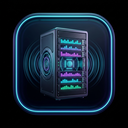

# Sentinel Music Desktop (Tauri v2 + WebView2)

<p align="center">
  
</p>

Легковесный, высокопроизводительный нативный десктопный клиент для экосистемы **Sentinel Music** на базе **Tauri v2 (Rust)** и Microsoft Edge WebView2.

---

## ✨ Преимущества перед Electron

- **Размер дистрибутива:** ~5.3 МБ установщик, ~12.5 МБ портативный `.exe` (вместо 150+ МБ у Electron).
- **Потребление оперативной памяти:** всего ~35–45 МБ RAM во время работы (вместо 300+ МБ).
- **Мгновенный запуск:** старт за доли секунды без оверхеда Chromium Node.js рантайма.
- **Интеграция с Windows:**
  - Системный трей с контекстным меню и быстрым скрытием/восстановлением окна по клику на иконку.
  - Сворачивание в трей при нажатии на крестик (музыка не прерывается).
  - Аппаратное медиа-управление и горячие клавиши.
  - Автоматическая поддержка сопряжения по QR-коду и зашифрованным крипто-токенам AES-256-GCM (`enc:v1:`).

---

## 🚀 Варианты сборки и запуска

Приложение поставляется в двух форматах:
1. **Портативный исполняемый файл (`Sentinel-Music-Portable.exe`):** не требует прав администратора и установки, запускается сразу из любой папки или с флешки.
2. **NSIS-установщик (`Sentinel-Music-Setup.exe`):** классический инсталлятор Windows с созданием ярлыков в меню «Пуск» и на рабочем столе.

---

## 🛠️ Локальная разработка и сборка

### Предварительные требования
- [Node.js](https://nodejs.org/) v18+
- [Rust & Cargo](https://rustup.rs/) (stable toolchain)
- WebView2 (встроен в Windows 10/11)

### Команды
```bash
# 1. Установка зависимостей
npm install

# 2. Запуск набора тестов (Node ассеты + Rust интеграционные тесты)
npm test
cargo test --manifest-path src-tauri/Cargo.toml

# 3. Запуск в режиме разработки с HMR
npm run dev

# 4. Продакшн сборка (портативный exe + установщики NSIS и MSI)
npm run build
```

Готовые бинарные файлы создаются по путям:
- **Портативный .exe:** `src-tauri/target/release/sentinel-music-desktop.exe`
- **NSIS Setup:** `src-tauri/target/release/bundle/nsis/Sentinel Music_1.0.0_x64-setup.exe`
- **MSI Setup:** `src-tauri/target/release/bundle/msi/Sentinel Music_1.0.0_x64_en-US.msi`

---

## 🤖 Автоматическая сборка (CI/CD GitHub Actions)

Каждый коммит и релизный тег автоматически собираются на виртуальной машине Windows в GitHub Actions:
- Проводятся автоматические тесты конфигурации и ассетов.
- Компилируется и упаковывается релизный бинарник.
- Артефакты сборки (`Sentinel-Music-Portable.exe` и `Sentinel-Music-Setup.exe`) загружаются в сводку пайплайна и релизы GitHub.
